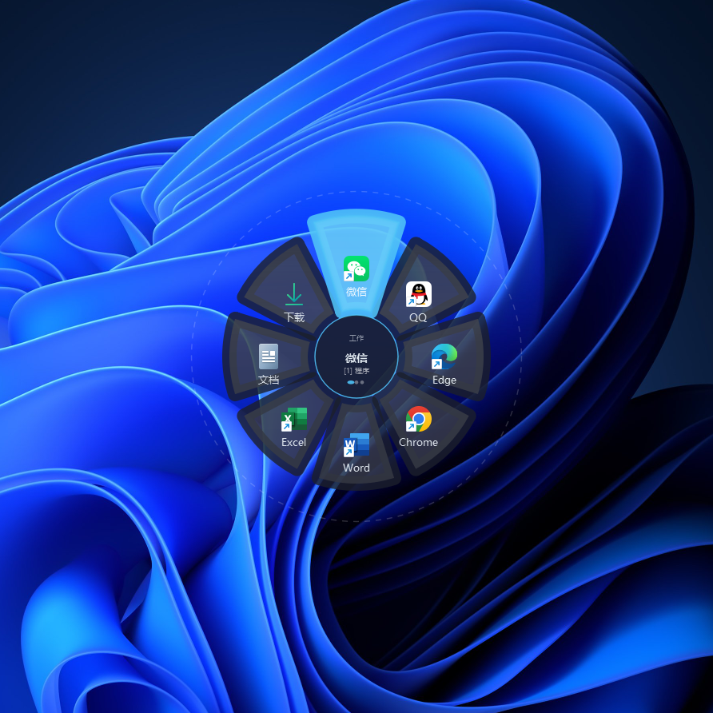
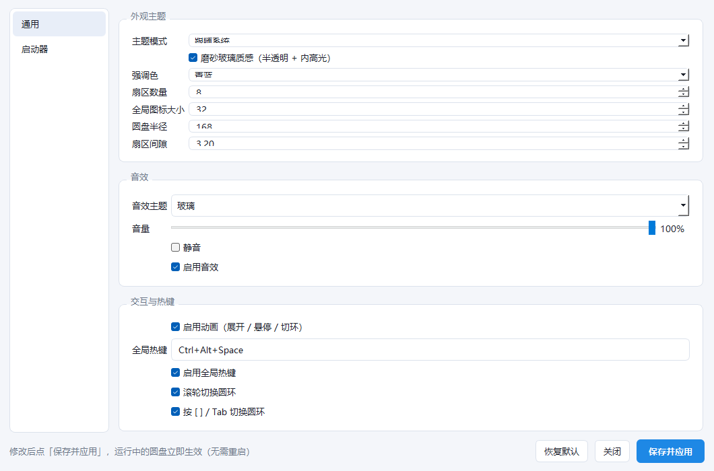

# 圆盘启动器 · Desktop Dial Launcher

> 一个 Windows 桌面上的「隐形环形启动器」：平时看不见，在桌面空白处**按住左键拖一下**，就在按下点弹出磨砂玻璃质感的圆盘菜单，**朝目标方向一甩、松手即启动**。
> 完全免费、以 **GPLv3** 开源，个人与企业均可自由使用、修改、再分发。



---

## 一、这是什么

桌面圆盘启动器把「桌面」本身变成启动器：程序常驻时只保留一个全局鼠标/键盘钩子线程，**没有任何常驻窗口**（不进任务栏、不进 Alt+Tab、任务栏预览里也看不到），平时你只会看到自己的壁纸。

**核心特性：**

| 特性 | 说明 |
|---|---|
| 按住拖动唤起 | 桌面空白处按下左键并拖过阈值（默认 12px）才弹圆盘；单击、双击、点图标、拖文件全部保持系统原行为 |
| 方向投掷选择 | 按住不放，朝哪个扇区方向移动就高亮哪个，松手执行（Pie Menu 手感） |
| 甩出取消 | 指针甩出「半径 + 取消余量」区域变橙提示，再甩远直接收起，不执行的误触也能一秒撤销 |
| 多圆环 | 可配置多个圆环（如「主环 / 工具盘 / 娱乐盘」），圆盘上滚轮、`[` `]`、`Tab` 即可切环 |
| 真实应用图标 | 通过 Windows Shell API 读取本机程序的真实图标，不是占位图 |
| 磨砂玻璃视觉 | 半透明底色 + 扇区圆角 + 外发光 + 阴影，跟随系统深浅色主题 |
| 全局热键 | 默认 `Ctrl+Alt+Space`，任意窗口下在光标处唤出圆盘 |
| 音效 | 3 套主题共 60+ 个程序合成音效（玻璃 / 机械 / 极简），悬停音高随扇区递进 |
| 图形配置窗 | 内置设置窗口：常规、外观、音效、热键、圆环与槽位编辑，改完即时热应用到运行中的圆盘 |
| 托盘左键菜单 | 左键单击托盘图标即弹完整菜单（不再必须右键），双击托盘直接唤出圆盘 |
| 无侵入 | 不写注册表、不装服务、不建计划任务、不需要管理员权限 |

### 界面预览

| 圆盘菜单 | 图形配置窗 |
|---|---|
|  |  |

---

## 二、快速开始

### 方式 1：直接用打包好的 exe（推荐给普通用户）

前往 Releases 下载对应压缩包，解压后直接运行：

| 版本 | 适用 | 说明 |
|---|---|---|
| `圆盘启动器.exe`（单文件版） | 只想双击就用 | 约 38 MB，免安装 Python；首次启动 0.8–1.6 s（需解包到临时目录） |
| `圆盘启动器\`（目录版） | 追求启动速度 | 约 99 MB，启动约 0.3 s，整个文件夹一起移动即可 |

- 两个版本都**自带 Python 与 Qt 运行库**，目标机器无需安装任何环境。
- 配置与日志位置：exe 所在目录可写时写在该目录；不可写（如放在 `C:\Program Files`）则自动迁到 `%APPDATA%\DesktopDial\`。**绝不写入临时解包目录**。
- 退出：托盘图标 →「退出」（主窗口不进任务栏，只能走托盘）。

### 方式 2：源码运行（推荐给开发者）

```bat
:: 1) 安装依赖（唯一必需：PyQt5）
pip install -r requirements.txt

:: 2) 带控制台运行（调试，可看日志）
python desktop_dial.py

:: 3) 免控制台运行（日常使用）
pythonw desktop_dial.pyw

:: 4) 指定配置文件
python desktop_dial.py --config "D:\my_config.json"

:: 5) 环境自检：读配置 → 装钩子 → 打印 JSON 结果 → 自动退出
python desktop_dial.py --selftest
```

环境要求：Windows 10 / 11（64 位）、Python 3.8+（验证环境为 Python 3.11.8）、PyQt5 5.15.11（Qt 5.15.2）。
**不需要 pywin32**，所有 Win32 调用均由标准库 `ctypes` 完成。

---

## 三、使用方法与快捷键

### 桌面手势

| 操作 | 结果 |
|---|---|
| 桌面空白处**单击** | 什么也不发生（系统原行为保留） |
| 桌面空白处**按住左键拖动 ≥ `drag_threshold`** | 在按下点弹出圆盘 |
| 拖动中把指针移向某扇区 | 该扇区高亮，中心显示「条目名 + 动作类型」 |
| 在扇区内**松开左键** | 执行该扇区动作，圆盘消失 |
| 按住后**原地松开**（仍在死区） | 取消，不执行 |
| 甩到 `radius + cancel_margin` 之外 | 进入取消态（外圈虚线变橙），继续甩远立即收起 |
| 弹出中按 `Esc` / 右键 / 中键 | 立即取消 |
| 在**其它窗口**里按住拖动 | 绝不唤起（只认 Progman / WorkerW 桌面窗口） |
| 在桌面**图标**上按住拖动 | 不唤起（交给系统原生图标拖拽） |

### 键盘与鼠标

| 快捷键 | 作用 |
|---|---|
| `Ctrl+Alt+Space`（可改） | 全局热键，在光标处唤出圆盘 |
| 圆盘可见时 `1` – `9` | 直接启动对应扇区（免移动鼠标） |
| 圆盘可见时 `Tab` / `[` / `]` | 切换到下一环 / 上一环（可在设置里关闭） |
| 圆盘可见时滚轮 | 切换圆环（可在设置里关闭） |
| `Esc` | 取消并收起 |
| 圆盘可见时单击左键 | 确认当前高亮扇区 |

### 托盘图标

| 操作 | 结果 |
|---|---|
| **左键单击** | 弹出完整菜单（延迟 220ms，给双击留窗口） |
| **右键单击** | 立即弹出同一份菜单 |
| **双击** | 直接唤出圆盘（并抑制随后的左键菜单） |

菜单项：预览圆盘、切换圆环（含当前环打勾）、打开设置…、重新加载配置、启用音效、音效主题（玻璃/机械/极简）、编辑配置文件（JSON）、打开配置文件所在文件夹、退出。

---

## 四、配置说明

配置为单个 JSON 文件（默认 `desktop_dial_config.json`），也可用 `--config` 指定。
仓库内的 [`example_config.json`](example_config.json) 是一份**开箱可用的脱敏示例**：路径全部写成 `%WINDIR%` / `%USERPROFILE%` 等环境变量，可直接复制改名后使用。

```bat
copy example_config.json desktop_dial_config.json
```

### 4.1 顶层字段

| 字段 | 默认 | 说明 |
|---|---|---|
| `version` | `2` | 配置结构版本 |
| `sectors` | `8` | 扇区数，建议 4 / 6 / 8 / 12；条目多于扇区则忽略多余，少于扇区则留空位 |
| `radius` | `168` | 外半径（逻辑像素，已按系统 DPI 缩放换算） |
| `inner_radius` | `52` | 中心圆盘半径（死区基准） |
| `icon_size` | `32` | 图标边长；扇区数 > 8 时自动缩小防挤压 |
| `font_size` | `10` | 标签字号，同样随扇区数自动缩放 |
| `drag_threshold` | `12` | 唤起阈值：位移超过该值（物理像素）才弹圆盘 |
| `cancel_margin` | `70` | 取消余量：超出 `radius + cancel_margin` 视为取消 |
| `dead_zone_ratio` | `0.5` | 死区半径 = `inner_radius × 该值`，防手抖误选 |
| `swallow_move_events` | `false` | 已废弃：低层钩子吞 `WM_MOUSEMOVE` 会冻结光标，现强制忽略，仅为兼容旧配置保留 |
| `ring_gap` | `6` | 多环的径向间隙（预留字段） |
| `switch_wheel` | `true` | 是否允许滚轮切环 |
| `switch_keys` | `true` | 是否允许 `[` `]` / `Tab` 切环 |
| `current_ring` | `0` | 当前使用的圆环索引（0 起） |

### 4.2 分组字段

| 分组 | 字段 | 说明 |
|---|---|---|
| `theme` | `follow_system` / `mode`（`auto`·`dark`·`light`） | 是否跟随系统深浅色，或强制指定 |
| `colors` | `base` `base_alpha` `empty_alpha` `accent` `accent_alpha` `text` `warn` | 底色/空扇区透明度/强调色/文字/取消提示色（`#RRGGBB` + 0–255 alpha） |
| `sound` | `enabled` `theme`（`glass`·`mechanical`·`minimal`）`volume` `mute` `backend`（`auto`·`async`·`qsound`）`hover_pitch` `hover_semitone` | 音效开关、主题、音量、播放后端与悬停音高 |
| `hotkey` | `enabled` / `sequence` | 全局热键开关与组合键，如 `Ctrl+Alt+Space` |
| `animation` | `enabled` `expand_ms` `collapse_ms` `hover_ms` `sector_gain` | 展开/收起/悬停动画时长与扇区放大系数 |
| `appearance` | `frosted` `glass_alpha` `gap_px` `sector_radius` `hub_name` `glow` `icon_shadow` | 磨砂玻璃、扇区间隙、圆角、中心是否显示名称、外发光、图标阴影 |
| `ui` | `geometry` `maximized` `nav_width` `splitter` | 设置窗口的几何与分栏记忆（由程序自动维护） |

### 4.3 多圆环与条目

```json
{
  "rings": [
    {
      "id": "ring1",
      "name": "主环",
      "accent": "",
      "icon_size": 0,
      "items": [
        { "label": "记事本", "type": "app", "target": "%WINDIR%\\System32\\notepad.exe",
          "args": "", "icon": "", "hotkey": "", "slot": 0 }
      ]
    }
  ]
}
```

- `rings` 为圆环数组，**顺序即切换顺序**；`current_ring` 指向当前环。
- 每个 `items` 条目的字段：

| 字段 | 说明 |
|---|---|
| `label` | 显示名称 |
| `type` | 槽位类型：`app` / `file` / `folder` / `url` |
| `target` | 目标：可执行文件、文件、文件夹路径或 URL。**支持环境变量**（`%WINDIR%`、`%USERPROFILE%`、`%APPDATA%` 等） |
| `args` | 启动参数（如 `shell:RecycleBinFolder`、`--incognito`） |
| `icon` | 自定义图标路径；留空则自动取目标程序的真实图标 |
| `hotkey` | 预留：该条目的独立热键 |
| `slot` | 扇区序号，`0` 从正上方开始顺时针排列 |

- 顶层 `items` 为旧版单环结构，保留用于向后兼容；若存在 `rings`，以 `rings` 为准。

### 4.4 环境变量写法

```json
"%USERPROFILE%\\Downloads"                  // 下载
"%WINDIR%\\System32\\notepad.exe"           // 系统程序
"%APPDATA%\\Microsoft\\Windows\\Start Menu\\Programs\\..."  // 开始菜单快捷方式
"https://github.com"                        // type: url 时直接填链接
```

> 发布/分享配置文件前，请把 `C:\Users\你的用户名\...` 一类绝对路径替换为 `%USERPROFILE%\...`，避免泄露个人目录。

---

## 五、从源码构建 exe

```bat
:: 1) 准备环境（开发验证环境：Python 3.11.8 / PyQt5 5.15.11 / PyInstaller 6.22.3）
pip install -r requirements.txt
pip install pyinstaller

:: 2) 单文件版（onefile）
pyinstaller --noconfirm --clean --onefile --windowed ^
  --name "圆盘启动器" --icon desktop_dial.ico ^
  --add-data "sounds;sounds" ^
  desktop_dial.py

:: 3) 目录版（onedir，启动更快）
pyinstaller --noconfirm --clean --onedir --windowed ^
  --name "圆盘启动器" --icon desktop_dial.ico ^
  --add-data "sounds;sounds" ^
  desktop_dial.py
```

**资源冻结规则（代码内已处理，改代码时请遵守）：**

| 函数 | 用途 | 冻结后行为 |
|---|---|---|
| `is_frozen()` | 判断是否 PyInstaller 运行 | 检查 `sys.frozen` |
| `resource_dir()` | **只读**资源（`sounds/`、`desktop_dial.ico`） | 指向 `sys._MEIPASS`（单文件版的临时解包目录） |
| `data_dir()` | **可写**数据（配置、日志） | 优先 exe 同目录；不可写则 `%APPDATA%\DesktopDial\`。**绝不写 `_MEIPASS`** |

因此新增任何资源文件时：读取用 `resource_dir()`，写入用 `data_dir()`。

**音效重新生成（可选）**：`sounds/` 下 3 套主题共 60 个 WAV 由项目自带合成脚本用 numpy 生成，运行程序本身**不需要 numpy**，打包时也不会包含它。

---

## 六、目录结构

```
DesktopDial/
├── desktop_dial.py         主程序（钩子线程 + 圆盘绘制 + 托盘 + 动作分发 + 设置窗）
├── desktop_dial.pyw        免控制台入口（pythonw / 双击）
├── desktop_dial.ico        程序图标（自绘）
├── sounds/                 音效（glass / mechanical / minimal 三套，程序合成）
├── example_config.json     脱敏示例配置（路径使用环境变量）
├── requirements.txt        运行依赖（PyQt5）
├── LICENSE                 GNU GPL v3 全文
├── NOTICE                  第三方组件与许可声明
├── docs/                   README 预览图
└── .gitignore
```

运行时才会生成、**不纳入版本库**的文件：`desktop_dial_config.json`（你的个人配置）、`*.log`（日志）、`build/` `dist/` `release/`（打包产物）。

---

## 七、常见问题

**Q：为什么单击桌面不弹圆盘？**
A：设计如此。单击唤起会吃掉「点图标、框选、右键菜单」等系统原行为，实测干扰太大，因此改为「按住拖动过阈值」这一个明确手势。

**Q：圆盘弹不出来？**
A：① 确认鼠标真的在**桌面壁纸**上（不是某个窗口、不是桌面图标上）；② 位移要超过 `drag_threshold`；③ 用 `python desktop_dial.py --selftest` 看钩子是否安装成功；④ 检查日志（`data_dir()` 下的 `desktop_dial.log`）。

**Q：热键没反应？**
A：`Ctrl+Alt+Space` 可能被其它软件（输入法、录屏工具）占用，注册失败会写日志并在托盘提示；到设置里换一个组合即可。

**Q：开机自启？**
A：本程序**不写注册表和计划任务**。需要自启时，自己把 `desktop_dial.pyw`（或 exe）的快捷方式放进
`%APPDATA%\Microsoft\Windows\Start Menu\Programs\Startup`。

**Q：能用于商业环境吗？**
A：可以，**个人与企业都完全免费**。但本项目使用 PyQt5（GPLv3）开发，因此整体以 GPLv3 发布：你可以自由使用、修改、内部部署、再分发，再分发时须遵循 GPLv3（提供完整对应源码、保留版权与许可声明）。若你的产品需要闭源分发，需自行向 Riverbank 购买 PyQt 商业授权，或改用本项目的思路重写 UI 层。

---

## 八、许可证

本项目以 **GNU General Public License v3.0（GPLv3）** 发布，许可证全文见 [LICENSE](LICENSE)。

```
Copyright (C) 2026 Jacky

This program is free software: you can redistribute it and/or modify
it under the terms of the GNU General Public License as published by
the Free Software Foundation, either version 3 of the License, or
(at your option) any later version.

This program is distributed in the hope that it will be useful,
but WITHOUT ANY WARRANTY; without even the implied warranty of
MERCHANTABILITY or FITNESS FOR A PARTICULAR PURPOSE.  See the
GNU General Public License for more details.
```

**你可以免费获得的自由**：任何目的（含商业用途）运行本程序；研究并修改源码；再分发副本；分发你修改后的版本。

**再分发时的义务**：附带完整源码或可获取源码的书面承诺；保留版权声明与 GPLv3 声明；同样以 GPLv3 授权衍生作品；不额外附加限制。

### 第三方组件

| 组件 | 版本 | 许可 | 用途 |
|---|---|---|---|
| PyQt5 | 5.15.11 | GPL v3 / 商业双授权（Riverbank） | GUI、托盘、多媒体 |
| Qt | 5.15.2 | LGPL v3 / GPL v3 | PyQt5 底层框架 |
| Python | 3.11.8 | PSF License | 运行环境（随 exe 打包） |
| numpy | 2.4.6 | BSD-3-Clause | **仅开发期**合成音效，运行时不使用、不打包 |
| PyInstaller | 6.22.3 | GPL 2.0+（含 bootloader 例外） | **仅打包期**使用，源码运行不需要 |

音效与图标均为本项目原创（程序合成 / 自绘），随本项目一并按 GPLv3 发布。详见 [NOTICE](NOTICE)。

---

## 九、致谢

交互设计借鉴了饼菜单（Pie Menu）的经典研究，以及 PixPin、罗技环形菜单、Quicker 等产品在「方向投掷选择 + 甩出取消」上的手感处理。程序本身为独立实现，未使用任何上述产品的代码或素材。

如果这个工具让您的桌面顺手了一点，欢迎 Star、提 Issue、提 PR。
